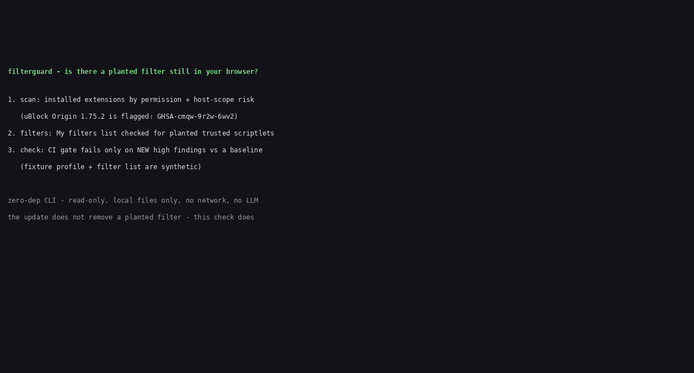

# filterguard

Audit what is already in your browser - and answer the one question the patch does not.



Updating uBlock Origin past [GHSA-cmqw-9r2w-6wv2](https://github.com/gorhill/uBlock/security/advisories/GHSA-cmqw-9r2w-6wv2) closes the hole. It does **not** remove a filter the attack already planted. That rule sits in your own "My filters" list, next to rules you wrote yourself, until somebody checks it. `filterguard` is that check - plus an audit of every installed extension by permission and host-scope risk - in one local command with a CI gate.

## Why

On 15 November 2026, researcher Smitty van Bodegom published a one-click universal XSS in uBlock Origin (Hacker News #6, 555 points / 160 comments). A malicious page could drive the element picker with `postMessage` plus one clickjacked click and smuggle a newline into the picker's `opt` field to append a full **trusted scriptlet** filter - for example `trusted-rpnt` scoped to `google.com`. Picker-created rules are saved to **My filters** with `trustedSource: true`, so the scriptlet runs JavaScript on every site the victim later visits. GitHub advisory [GHSA-cmqw-9r2w-6wv2](https://github.com/gorhill/uBlock/security/advisories/GHSA-cmqw-9r2w-6wv2) rates it High; versions 1.75.2 and lower are vulnerable, 1.75.4 is patched, and **1.76.4 or newer** (as of 17 November 2026) is the version to be on. No exploitation in the wild has been reported.

The fix series stops untrusted pages from reaching the picker. It does **not** revisit what the picker already saved - the function that saves picker rules is byte-identical in 1.75.2 and 1.76.4, and no release in the fix series deletes a planted filter (Medium / Chinmay Shringi, 16 November 2026). So the correct action after updating is a 30-second check of My filters - and nobody runs that check, because no tool does it. This is that tool.

The extension half has the same shape of problem. The standard free extension auditor, CRXcavator, was killed in 2023 with no replacement. The December 2025 ShadyPanda campaign put spyware into about 4.3M Chrome and Edge installs over seven years. A February 2026 Barracuda report found 99% of employees have browser extensions installed and 52% have more than ten. The manual audit path is `chrome://extensions` plus reading each manifest by hand.

## What it does

- `filterguard scan` - discovers browser profiles (Chrome, Chromium, Brave, Edge, Firefox) and audits every installed extension from its `manifest.json`: name, version, permissions, host scope, content scripts, update channel, manifest version. Flags uBlock Origin below 1.76.4 as HIGH.
- `filterguard filters` - parses an ABP-syntax filter file (uBO "My filters" export, AdGuard custom filters). Any `trusted-*` scriptlet not in your baseline is HIGH. Broad-scope `$redirect` / `$csp` rules are HIGH; block-all `$document` / `$popup` rules are MEDIUM. Exception rules, cosmetic hiding rules, and ordinary network blocks are never flagged.
- `filterguard check` - the CI/local gate: scan + filters together, fails (exit 1) only on HIGH findings not covered by the baseline.
- `filterguard explain <rule-or-extension>` - every evidence item behind one finding, with what to do next.
- `filterguard init` - writes `filterguard.config.json` and prints the My filters export path for your browser.
- `filterguard diff <baseline-a> <baseline-b>` - new / fixed / unchanged findings between two baselines.

Exit codes: 0 = no HIGH finding, 1 = at least one HIGH finding, 2 = usage error or nothing to audit.

## Quickstart

Install from source for now (the npm package `filterguard` is unclaimed as of 17 November 2026; publishing is pending):

```sh
git clone https://github.com/techdevfun/filterguard.git
cd filterguard
npm install
npm run build
npm link   # or run ./dist/cli.js directly
```

Export your filter list first (the live list lives in extension storage, not a plain file):

- uBlock Origin: Dashboard -> My filters -> Export
- AdGuard: Settings -> User rules -> Export

Then:

```sh
filterguard init
filterguard check --filters ~/Downloads/my-filters.txt
```

Example output (synthetic fixture - see Demo):

```text
target                                                     severity reason
----------------------------------------------------------------------------------------------------------
uBlock Origin 1.75.2 (cjpalhdlnbpafiamejdnhcphjbkeiagm)   HIGH     uBlock Origin 1.75.2 is VULNERABLE to GHSA-cmqw-9r2w-6wv2
  evidence: uBlock Origin 1.75.2; vulnerable <= 1.75.2, fixed 1.75.4, recommended 1.76.4+ (GHSA-cmqw-9r2w-6wv2)
  fix: Versions 1.75.2 and lower are vulnerable. Update to 1.76.4 or newer, then run `filterguard filters` - the update does NOT remove a filter the attack already planted.
line 5: example.com#%#//scriptlet('trusted-rpnt', 't... HIGH     trusted scriptlet trusted-rpnt runs JavaScript on example.com; planted-filter vector: GHSA-cmqw-9r2w-6wv2
  evidence: line 5, sha256 29346360a4e3
  fix: Open uBlock Origin Dashboard -> My filters, find line 5, and delete this rule if you did not write it.

summary: HIGH 5 | MEDIUM 2 | LOW 1 | profiles 1 | extensions 2 | rules parsed 5
```

## Demo

The GIF above is rendered from a real transcript (`demo/transcript.txt`, captured by `scripts/capture-demo.sh`): scan on a synthetic fixture profile (uBlock Origin **1.75.2** plus one `<all_urls>` note-taking extension), filters on a synthetic My filters file containing the planted `trusted-rpnt` rule, check failing, explain on the planted rule, then the fix - update uBO to 1.76.4, delete the planted rule, baseline the reviewed state - and check passing with exit 0. Fixtures are synthetic and labelled as such in the transcript and here; the planted rule shape is from the public advisory write-ups, on a fixture domain, never a real victim.

## Head-to-head

| Tool | What it does | Where filterguard differs |
|---|---|---|
| **CRXcavator** (Duo Labs / Cisco) | Pulled a CRX apart by ID: permissions, risk tiers, 0-100 score | **Dead - killed 2023, no replacement.** filterguard is the local successor for the installed-profile half, plus the filter-list half CRXcavator never had. |
| **crx-analyzer** (PyPI) | Local Python: downloads the CRX by ID, parses manifest permissions, 0-100 score | Store-download only, one extension at a time, no audit of what is actually installed in your profiles, no filter-list parsing. filterguard is zero-dep Node, profile-first, and parses filters. |
| **Spin.AI** | Enterprise browser-extension security SaaS | $5,000/year minimum, cloud upload of extension inventory. filterguard is free, local, no data leaves the machine. |
| **Chrome Extension Security Analyzer** (Apify) | Cloud pay-per-use ($0.20/extension): permission tiers, content-script analysis | Cloud service, per-extension, store-fetched. No local profile audit, no filter lists, no baseline/CI gate. |
| **Extension Auditor Pro** (Chrome Web Store) | An extension that audits installed extensions on-device | Closest rival for the permission half - but it IS an extension (you install more extension code to audit extensions), and it does not parse uBO/AdGuard filter lists. |
| **PlayCISO Extension Scanner** | Web tool + npm CI gate: live manifest pull from the store by ID | Store-fetched by ID, not an audit of installed profiles; no filter-list parsing; source private, part of a paid platform. |
| **uBlock Origin itself (1.76.0+)** | Validates filters before the picker creates them | Validates at creation time only. Never audits the My filters list that already exists. filterguard is the audit uBO does not do. |
| **toolwatch** (same factory, #16) | Snapshots extension/plugin dirs + sha256, diffs drift | Drift detection on file hashes. Does not understand permission semantics, host scope, or filter-list content - a planted filter inside an unchanged file is invisible to it. |
| **extverify** (same factory, #15) | Pre-install verification: publisher identity, marketplace trust, hash pinning | Pre-install only. Says nothing about what is already installed or already in My filters. |

**Where rivals beat us, honestly:** crx-analyzer downloads and inspects the actual CRX code (URL extraction from code) - filterguard v0.1.0 reads manifests + filter text only and does not decompile extension code. Spin.AI / PlayCISO cover fleet policy and store-freshness signals filterguard does not. Extension Auditor Pro runs inside the browser and sees live extension state. filterguard v0.1.0 is a static local audit of manifests + filter lists, not a runtime behavioural monitor, and says so on every output.

## Commands

```sh
filterguard scan [--profile-dir <dir>] [--browser chrome|chromium|brave|edge|firefox] [--json] [--save-baseline <file>]
filterguard filters [--filters <file>] [--json] [--save-baseline <file>]
filterguard check [--profile-dir <dir>] [--filters <file>] [--baseline <file>] [--json]
filterguard diff <baseline-a> <baseline-b> [--json]
filterguard explain <rule-or-extension-id> [--profile-dir <dir>] [--filters <file>] [--json]
filterguard init
```

`--json` prints the same findings plus a manifest (checkedAt, tool version, per-finding evidence with file paths + line numbers).

## Verdict rules

Extension score (capability, not proof of malice):

| Signal | Weight |
|---|---|
| `<all_urls>` host access | 40 |
| `debugger` permission | 30 |
| `management` permission | 25 |
| `webRequestBlocking` permission | 25 |
| `nativeMessaging` / `proxy` permission | 20 |
| `cookies` on all hosts | 20 |
| `tabs` + `webNavigation` combo | 15 |
| Content script on all urls at `document_start` | 15 |
| Off-store update URL | 15 |
| Manifest V2 on Chromium | 10 |
| Scoped host access | 5 |

Score 40+ = HIGH, 20-39 = MEDIUM, 1-19 = LOW, 0 = OK. The extension severity is the worse of its score band and its worst single finding.

uBlock Origin version gate (GHSA-cmqw-9r2w-6wv2, checked 17 November 2026): below 1.75.4 = HIGH (vulnerable); 1.75.4-1.76.3 = MEDIUM (patched but older than the recommended 1.76.4); 1.76.4+ = OK (still run `filterguard filters` - the update does not remove a planted filter).

Filter rules: any `trusted-*` scriptlet not in the baseline = HIGH; broad-scope `$redirect` / `$redirect-rule` / `$csp` = HIGH; scriptlet/redirect scoped to `*` or with no domain = HIGH; `$document` / `$popup` block-all = MEDIUM. Exception rules (`@@...`), plain cosmetic hiding rules (`##...`), and ordinary network blocks are never flagged.

A HIGH score is about capability. A content blocker legitimately needs broad host access, and advanced users do write `trusted-*` scriptlets on purpose - uBO documents them for trusted lists. That is what the baseline is for: `scan` / `filters --save-baseline` records the state you reviewed, keyed by sha256 of the rule text (whitespace-insensitive) or of the extension + finding. `check` then fails only on NEW high findings. Never allowlist a rule you do not recognise, and never let the tool delete anything - it reports, you remove.

## CI flow

```yaml
# .github/workflows - runs on Node 20.x and 22.x
- npm ci
- npm run build
- npm run lint
- npm test
- node --test test/live.test.js   # soft-skips on network failure
- node scripts/preflight.js
```

Use it as a gate on your own machines: commit a reviewed `filterguard.baseline.json`, then run `filterguard check --baseline filterguard.baseline.json` in CI or on a schedule. A new HIGH finding fails the gate; a fixed one is listed, not failed.

## Honest limits

- Manifest + filter-list audit only. It does not inspect extension code, runtime behaviour, or store-freshness. "No HIGH findings" is not "browser is safe".
- v0.1.0 reads an exported filter file. The live My filters list lives in extension storage (LevelDB/IndexedDB), not a plain file; direct storage read is on the roadmap. `init` prints the exact export path.
- Firefox profiles are read from `extensions.json`, which lists add-ons but not their permissions - those extensions are reported with a LOW "manifest not readable" note and no permission findings. The uBO version gate still applies.
- The parser is conservative: unknown rule kinds become counted parse warnings, never silent drops. uBO-specific `$` options and AdGuard extensions it does not recognise are warned, not guessed.
- Name check (17 November 2026): npm `filterguard` is unclaimed (404), GitHub `techdevfun/filterguard` is unclaimed (404), npm search returns no same-name package. One same-name product exists in a different category - "FilterGuard", a WordPress plugin by GrootMade - which is not a browser-extension or filter-list audit tool.
- Version guidance is pinned to the check date, 17 November 2026, with sources (advisory + releases page). If a newer patched uBO ships, the recommended version in the code goes stale - re-check the releases page.

## Live checks (17 November 2026, build machine)

- GHSA advisory page `https://github.com/gorhill/uBlock/security/advisories/GHSA-cmqw-9r2w-6wv2` returns 200. (Note: the global `github.com/advisories/GHSA-cmqw-9r2w-6wv2` URL returns 404 to curl; the repo-scoped URL is the canonical one and is what the live test checks.)
- uBlock Origin latest stable release is **1.76.4**, published 15 November 2026; latest pre-release is 1.76.5b0 (16 November 2026). Guidance "1.76.4 or newer" stands.
- npm `filterguard` returns 404; GitHub `techdevfun/filterguard` returns 404 via PAT-A.
- This build machine has no usable browser profile: `~/.config/chromium` and `~/.config/google-chrome-for-testing` contain only Crash Reports, no profile directory, no extensions. The live `scan` step is therefore recorded as "no profiles found" - no profile was faked for the demo; the demo uses a synthetic fixture profile instead.
- Hacker News thread: 555 points / 160 comments at the time the blueprint was drafted (17 November 2026).

## Roadmap

- Read live My filters directly from uBO/AdGuard extension storage (LevelDB/IndexedDB) instead of requiring an export.
- CRX code inspection (URL extraction) for the extensions that score HIGH, to close the gap with crx-analyzer.
- Fleet mode: one baseline per machine, one report for a team.
- Store-freshness signal: flag extensions whose store listing vanished or whose publisher changed.

## License

MIT. See [LICENSE](LICENSE).
